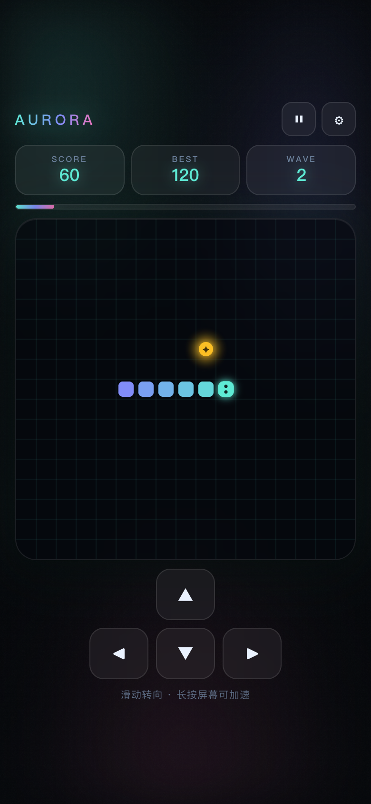
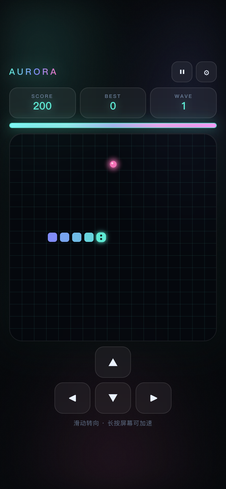
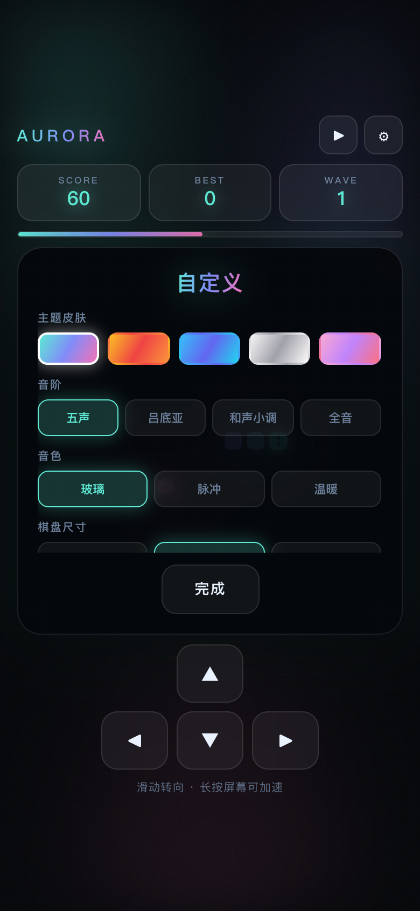

# AURORA SNAKE

极光贪吃蛇 —— 玻璃拟态 UI + 程序化音效 + 5 种道具的单文件贪吃蛇游戏。

A single-file neon snake game with glassmorphism UI, procedural audio synthesis, and five power-ups. Zero dependencies, zero build step — open the HTML and play.

**[▶ 在线试玩](https://lnuxe.github.io/aurora-snake/)** · [GitHub Pages](https://lnuxe.github.io/aurora-snake/) · [Release v1.0.0](https://github.com/lnuxe/aurora-snake/releases/tag/v1.0.0)



## 特性

### 视觉
- **玻璃拟态 UI** —— 半透明卡片、背景模糊、细边框、内高光，参考 iOS 26 Liquid Glass 的深度分层
- **极光动态背景** —— 三层径向渐变缓慢漂移，叠加噪点质感
- **平滑蛇身** —— 从头到尾颜色插值渐变，头部带光晕与朝向眼睛
- **食物呼吸** —— 多层光晕脉冲动画

### 五套主题

| 主题 | 蛇身 | 食物 |
|---|---|---|
| 极光 Aurora | `#5EEAD4` → `#818CF8` | `#F472B6` |
| 余烬 Ember | `#FBBF24` → `#EF4444` | `#FB923C` |
| 深海 Ocean | `#38BDF8` → `#6366F1` | `#22D3EE` |
| 墨白 Mono | `#F4F4F5` → `#A1A1AA` | `#FAFAFA` |
| 樱 Sakura | `#F9A8D4` → `#C084FC` | `#FB7185` |

### 程序化音效

所有声音由 WebAudio 振荡器实时合成，不含任何音频文件。

- **4 种音阶**：五声、吕底亚、和声小调、全音
- **3 种音色**：玻璃（三角波 + 泛音层）、脉冲（方波）、温暖（正弦波）
- **连击升调**：吃到食物时按连击数在音阶上逐级取音，音程由音阶决定，因此听起来是旋律而非提示音

```js
// 音阶定义（半音偏移）
pentatonic: [0, 2, 4, 7, 9, 12, 14, 16, 19, 21, 24]
lydian:     [0, 2, 4, 6, 7, 9, 11, 12, 14, 16, 18, 19, 23, 24]
minor:      [0, 2, 3, 5, 7, 8, 11, 12, 14, 15, 17, 19, 20, 23, 24]
whole:      [0, 2, 4, 6, 8, 10, 12, 14, 16, 18, 20, 22, 24]
```

### 五种道具

| 符号 | 名称 | 效果 | 持续 |
|---|---|---|---|
| ◈ | 幽灵 | 穿墙，免疫自咬 | 6s |
| ◷ | 缓时 | 减速 | 6s |
| ✦ | 双倍 | 双倍得分 | 8s |
| ◉ | 磁吸 | 食物向蛇头移动 | 7s |
| ◐ | 收缩 | 身体缩短 30% | 立即 |

食物有 15% 概率携带道具（蛇长 > 4 时）。

### 能量爆发

吃到食物累积能量（普通 +12，道具 +22）。攒满 100 后能量条发光，点击释放：

```
奖励 = 50 + 波次 × 10 + 连击 × 5
```

触发全屏粒子、震屏与音效，能量归零。



### 自定义

设置面板可调整主题、音阶、音色、棋盘尺寸（13 / 17 / 21）、初始速度（悠闲 260ms / 标准 200ms / 疾速 150ms）、音效开关、震屏开关，全部持久化到 `localStorage`。



## 手感设计

参考 game-feel 的反馈原则：反馈应当**分层、夸张但短暂、按重要性分级**。

- **震屏** —— trauma 平方衰减（`shake = trauma²`），驱动视觉偏移而非游戏坐标，用采样正弦而非逐帧随机，避免抖动感
- **连击倍率** —— 连续吃到 3 个以上食物，得分按连击数翻倍
- **波次加速** —— 每 80 分进入下一波，速度递减 14ms，下限 85ms
- **卡片弹跳** —— 分数变化时弹性缩放（`cubic-bezier(.34,1.56,.64,1)`）
- **死亡反馈** —— 红闪 + 震屏 + 震动 + 结算面板，破纪录时标题变色

## 触控

- **滑动即时响应** —— 使用 `touchmove` 而非 `touchend`，转向无延迟
- **连续滑动** —— 每次转向后重置基准点，支持一次滑动内多次转向
- **长按加速** —— 按住 260ms 进入 1.8 倍速，松开恢复
- **触控目标** —— 方向键 62×54px，高于 Material 48dp 与 Apple 44pt 标准
- **安全区适配** —— `env(safe-area-inset-*)` 处理刘海与手势条

## 性能

| 优化 | 做法 |
|---|---|
| 静态层缓存 | 网格线绘制到离屏 canvas，每帧仅 `drawImage` |
| DPR 限制 | `min(devicePixelRatio, 2)`，避免高分屏过度渲染 |
| 固定时间步 | 累加器驱动逻辑更新，不同帧率下速度一致 |
| 脏标记 | 死亡后仅在状态变化时重绘 |

实测稳定 **60 FPS**（Chrome，390×844，DPR 2）。

## 使用

```bash
git clone https://github.com/lnuxe/aurora-snake.git
cd aurora-snake
open src/aurora_snake.html
```

或直接在浏览器中打开 `src/aurora_snake.html`。

**操作**：滑动屏幕或方向键转向，长按屏幕加速，空格暂停。

## 文件

| 路径 | 说明 |
|---|---|
| `src/aurora_snake.html` | 完整版（39KB），含音效引擎与全部道具 |
| `src/aurora_snake_lite.html` | 精简版（19KB），移除音效与道具，便于移植 |

## 技术栈

原生 HTML + CSS + Canvas 2D + WebAudio，无框架、无构建、无依赖。

## License

MIT
